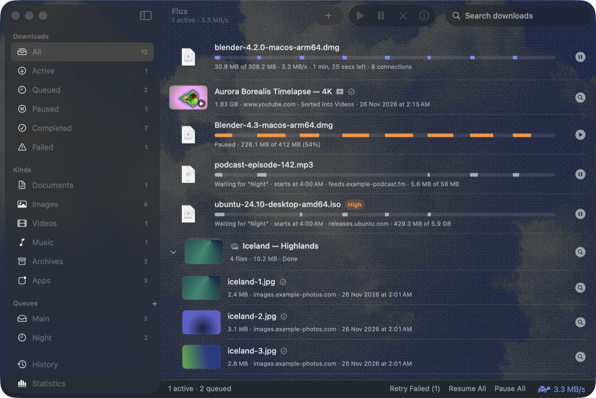
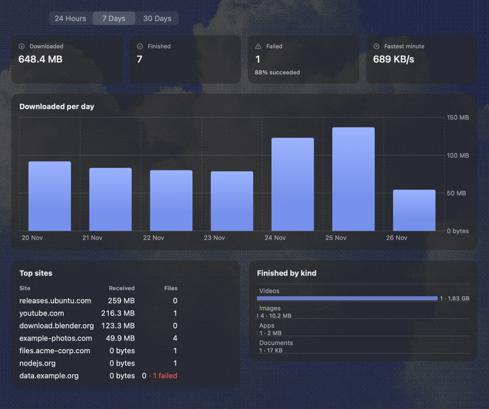
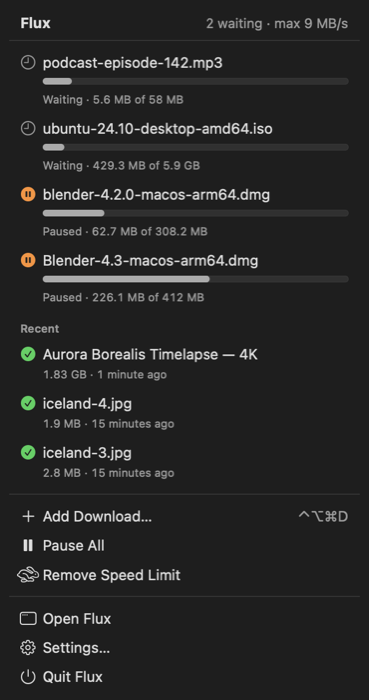
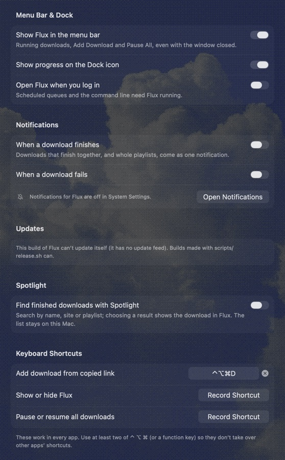
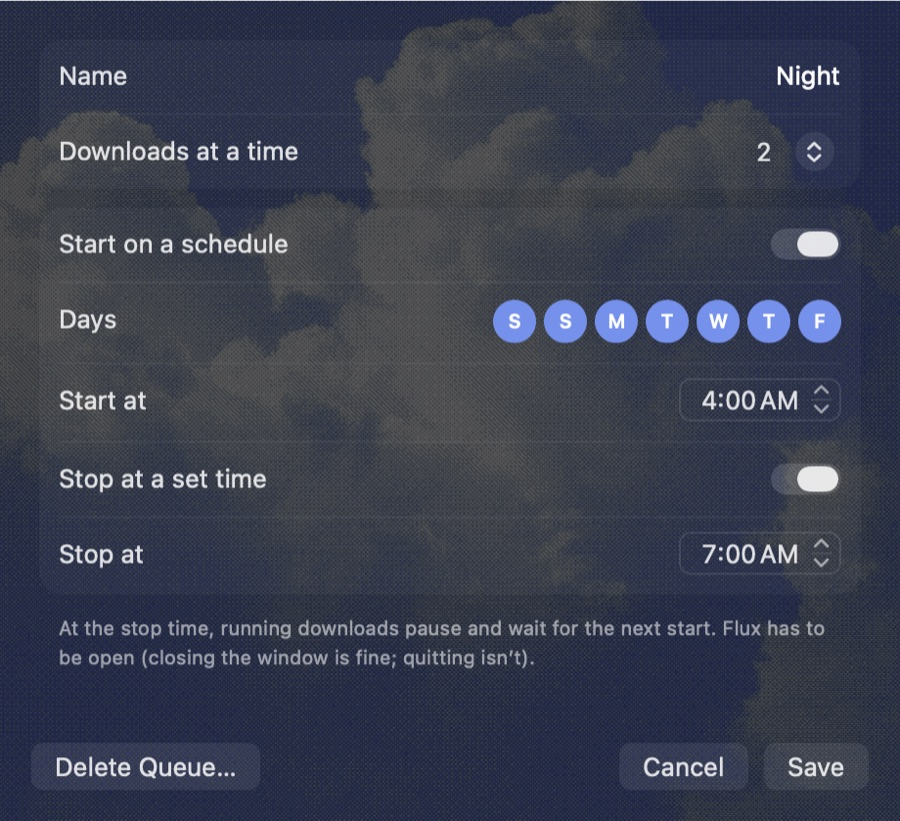

<div align="center">


# Flux

**Everything you download. Under control.**

A fast, native download manager for macOS: files, videos, playlists and image galleries,
in one calm window.

[**Download the latest release**](https://github.com/saifGawdat/flux/releases/latest) ·
macOS 14 or later · Apple Silicon

<br>



</div>

<br>

## Contents

- [Why Flux](#why-flux)
- [Every feature](#every-feature)
- [Screenshots](#screenshots)
- [Install](#install)
- [Command line](#command-line)
- [Build from source](#build-from-source)
- [Privacy & security](#privacy--security)
- [Project docs](#project-docs)

## Why Flux

- **Fast.** Up to 32 connections per file, with the work spread out again as each finishes.
- **Reliable.** Pause and quit at any time; downloads resume where they stopped, even after a crash.
- **Correct.** Every file is checked for gaps and exact size, and against a checksum if you give one, before it appears.
- **Tidy.** Rules sort, rename and unpack files the moment they finish.
- **Native.** SwiftUI and AppKit, plus the menu bar, notifications, Quick Look, Spotlight and a real command line.

## Every feature

### ⚡️ Downloading

- Multi-connection downloads using HTTP ranges (1–32 connections), with automatic single-connection fallback.
- Dynamic splitting: a connection that finishes takes over half of the largest remaining piece.
- Fewer connections automatically when a server refuses extra ones.
- Pause and resume, including after quitting or a crash (checkpoints are saved to disk).
- Change detection on resume (`If-Range`), so two versions of a file are never stitched together.
- Retry with exponential backoff.
- Validation before the file is placed: full coverage, no gaps, exact size. Rows show a seal when the size matches what the server stated.
- Safe file names, never overwriting anything (`name (1).ext`). Files get the quarantine flag and a "Where from" note, like Safari downloads.
- Priority per download: High, Normal or Low.
- A limit on simultaneous downloads.

### 🎬 Video, audio & images

- Video and audio from 1,800+ sites (YouTube, Vimeo, X, TikTok, Instagram, SoundCloud, …) through yt-dlp.
- Quality presets: Best, 4K, 1440p, 1080p, 720p, 480p MP4, MP3, M4A. The add sheet shows each preset's size.
- Whole playlists and channels: tick the videos you want; they're saved into a folder named after the playlist.
- Image galleries from Instagram, Reddit, Flickr, Tumblr and 100+ sites through gallery-dl, plus the pictures on any other web page, picked from a thumbnail grid.
- Links that turn out to be web pages are handed to the video tools automatically.
- Playlists and galleries show as one group you can collapse, with overall progress and group actions.
- Thumbnails in the list: a video's thumbnail while it downloads, then a Quick Look preview of the real file.

### 🛡 Speed, checksums & mirrors

- One speed limit for all downloads together, and one per download. Both change live, videos included (⌥⌘L toggles the overall limit).
- Checksums: paste a SHA-256, SHA-1, SHA-512 or MD5 (a whole `shasum` line works too). A file that doesn't match is discarded. Finished files can be checked later, or have their SHA-256 calculated.
- Mirrors: paste several links to the same file. Flux spreads connections across them, drops a mirror that serves a different file, and keeps going if one link dies.
- Expired links: Update Link… continues a failed download from a fresh link, after checking that it's the same file.
- Info window (⌘I): link, mirrors, checksum, size check, priority, speed limit.

### 🗂 Organizing

- Folders by kind (optional): Documents, Images, Videos, Music, Archives, Apps.
- Sidebar filters by status and by kind, with counts. Search covers names, titles, playlists and links.
- **Rules.** Conditions: extension, name pattern, site, link text, size or kind. Every condition must match, and the first matching rule wins. A matching rule can:
  - move the file to a folder
  - rename it with a pattern such as `{date} {name}`
  - extract it, if it's an archive
  - calculate its SHA-256
  - run a command
  - notify you, show it in Finder, or open it
- Duplicates: a new file identical to one you already have (same size, then same SHA-256) is marked, or moved to the Trash.
- Archives (optional): zip, tar.gz/bz2/xz, 7z and rar are extracted safely, quarantined and never overwrite anything.
- History: Clear Completed (⇧⌘K) moves finished downloads here, grouped by day, with search, Download Again and Clear History.

### ⏱ Queues & schedules

- Named queues alongside the main one. Each holds its downloads until you press Start.
- Schedules: choose days, a start time and an optional stop time (overnight works). At the stop time, running downloads pause and wait for the next start.
- Downloads-at-a-time per queue. Move downloads between queues with right-click › Queue.

### 📥 Import, export & clipboard

- Import Links… (⌘O) reads:
  - `.txt`: one link per line, plus aria2 `out=`, `dir=` and `checksum=` lines
  - `.csv`: with or without a header
  - `.json`
- Export Downloads writes text, CSV (safe to open in spreadsheets) or JSON, optionally including History.
- Clipboard (optional): copy a link to a file or video and a small panel asks whether to download it. Passwords from password managers are never read.

### 🍎 Built for macOS

- **Menu bar:** running downloads, recent ones, Add Download, Pause All and the speed limit, even with the window closed.
- **Notifications** for finished downloads (several at once, or a whole playlist, come as one notification) and for failures. They have Open, Show in Finder and Try Again buttons.
- **Dock:** a progress bar on the icon, a count badge, and a menu with quick actions.
- **Quick Look:** Space or ⌘Y previews finished files.
- **Spotlight:** search a download's name, site or playlist; choosing a result shows it in Flux.
- **Open at login.**
- **Global shortcuts** that work in any app: ⌃⌥⌘D adds a download from the copied link. Show/Hide Flux and Pause/Resume All can be assigned too.
- **Updates** install themselves, and only if they carry Flux's signature.

### 📊 Statistics & automation

- Statistics: downloaded per hour or per day over 24 hours, 7 days or 30 days. Also shows finished and failed counts, the fastest minute, top sites, and finished downloads by kind.
- Commands: zsh scripts that rules run on finished files, with the file as `$1`. A command runs only exactly as you approved it, for at most 5 minutes, and "Test on a File…" tries it once.

### ⌨️ Command line

- The `flux` command, installed from Settings › General, controls the running app: add, import, export, list, status, pause, resume, cancel, remove, limit, queues, stats.
- `--json` output on every command, and `--wait` that exits 0 only when every download succeeded.

## Screenshots

<table>
<tr>
<td width="62%"></td>
<td width="38%"></td>
</tr>
<tr>
<td align="center"><sub><b>Statistics:</b> what you downloaded, when, and from where</sub></td>
<td align="center"><sub><b>Menu bar:</b> everything at a glance, window closed</sub></td>
</tr>
<tr>
<td></td>
<td></td>
</tr>
<tr>
<td align="center"><sub><b>Settings › System:</b> menu bar, notifications, updates, Spotlight, shortcuts</sub></td>
<td align="center"><sub><b>Queues:</b> run big downloads overnight</sub></td>
</tr>
</table>

## Install

1. Download `Flux-x.y.z.dmg` from [Releases](https://github.com/saifGawdat/flux/releases/latest).
2. Open it and drag **Flux** into **Applications**.
3. Until releases are notarized by Apple, macOS blocks the first launch. Right-click Flux › **Open** › **Open**, or use System Settings › Privacy & Security › **Open Anyway**.

**Optional, for video, audio and galleries.** Flux handles direct file links and ordinary web pages by itself. For video sites and galleries, install these free tools once:

```sh
brew install yt-dlp ffmpeg gallery-dl
```

Flux finds them automatically; Settings › Media shows their status.
- Without ffmpeg, videos still download, but only in single-file formats (usually up to 720p on YouTube) and without MP3 conversion.
- gallery-dl reads `~/.config/gallery-dl/config.json`, so sites that need a login work once you add cookies there.
- Only download media you have the right to save.

## Command line

Install `flux` from **Settings › General › Command Line**. It talks to the running app (and opens it if needed), so Terminal and the window always agree.

```sh
flux add https://example.com/big.iso -o ~/ISOs --wait   # exits 0 only if it succeeded
cat links.txt | flux add - -q Night                      # queue a list for tonight
flux list                                                # what's going on
flux pause all && flux limit 500K
flux queue start Night
flux import links.csv
flux export --all > everything.json
flux stats month
```

Run `flux help` for every option.

## Build from source

You need macOS 14+ on Apple Silicon and Swift 6 (Xcode or the Command Line Tools).

```sh
./scripts/build-app.sh     # → build/Flux.app (hardened runtime, ad-hoc signed)
open build/Flux.app
./scripts/test.sh          # 213 tests (Swift Testing)
```

Engine tests run against `scripts/range_server.py`, a local HTTP server with Range/If-Range, throttling, redirects, expiring links and picky-CDN modes, so no public URLs are contacted. Opt-in live checks:

```sh
FLUX_LIVE_TESTS=1 ./scripts/test.sh --filter "LiveMediaTests|LiveCollectionTests"
```

<details>
<summary><b>Releasing a new version</b></summary>

```sh
# 1. Build, sign, (notarize) and write the update feed:
FLUX_VERSION=1.1.0 scripts/release.sh
#    For distribution add: FLUX_SIGN_IDENTITY="Developer ID Application: …" FLUX_NOTARY_PROFILE=flux-notary
# 2. Publish build/Flux-1.1.0.dmg and build/appcast.xml as GitHub release v1.1.0:
FLUX_VERSION=1.1.0 scripts/publish.sh
```

- Installed copies check `https://github.com/saifGawdat/flux/releases/latest/download/appcast.xml`. Override this with `FLUX_REPO` / `FLUX_FEED_URL` when building.
- The update signing key lives in the login Keychain. **Back it up:**
  ```sh
  .build/artifacts/sparkle/Sparkle/bin/generate_keys --account flux -x flux-update-key.txt
  ```
  Keep that file somewhere safe and private. Without it, existing installs can't be updated.
- The release checklist is in [docs/SECURITY.md](docs/SECURITY.md#release-checklist).

</details>

<details>
<summary><b>Screenshots without screen recording (developer aid)</b></summary>

```sh
FLUX_SNAPSHOT=/tmp/flux.png build/Flux.app/Contents/MacOS/Flux                     # the list
FLUX_SNAPSHOT=/tmp/flux.png FLUX_SNAPSHOT_DARK=1 build/Flux.app/Contents/MacOS/Flux # dark
FLUX_SNAPSHOT=/tmp/add.png FLUX_SNAPSHOT_ADD="https://…" build/Flux.app/Contents/MacOS/Flux
FLUX_SNAPSHOT=/tmp/info.png FLUX_SNAPSHOT_INFO=0 build/Flux.app/Contents/MacOS/Flux
FLUX_SNAPSHOT=/tmp/view.png FLUX_SNAPSHOT_VIEW=statistics build/Flux.app/Contents/MacOS/Flux
```

`FLUX_SNAPSHOT_VIEW` can be any of:
- settings tabs: `general`, `organize`, `automation`, `system`
- other screens: `rule`, `statistics`, `menubar`, `history`, `queue`, `queues`, `clipboard`, `import` (reads `FLUX_SNAPSHOT_FILE`)

Add `FLUX_DATABASE=/path/demo.sqlite` to use a separate database.

</details>

## Privacy & security

- **Local only.** No accounts, no analytics. Statistics, history and the Spotlight index never leave your Mac.
- **Private files.** The database is readable only by you, and the command socket accepts only your user.
- **Safe imports and archives.** Imported link lists can't place files in `~/Library` or hidden folders, and archives can't write outside their folder.
- **Commands you approved, and nothing else.** A command runs only exactly as you approved it, and file names never become part of the command.
- **Signed updates.** An update is installed only if it carries Flux's EdDSA signature.

The full review is in [docs/SECURITY.md](docs/SECURITY.md).

<details>
<summary><b>Where Flux keeps things</b></summary>

- Database: `~/Library/Application Support/Flux/flux.sqlite` (owner-only)
- Command socket: `~/Library/Application Support/Flux/control.sock`
- Partial downloads: `<name>.<id>.fluxpart` next to the destination file
- Traffic history: the `traffic` table, kept 90 days
- Spotlight: domain `app.flux.downloads` (removed when you turn it off)
- Logs: `log stream --predicate 'subsystem == "app.flux"'`

</details>

## Project docs

| | |
|---|---|
| [Roadmap](docs/ROADMAP.md) | What's done in each phase and what's next |
| [Architecture](docs/ARCHITECTURE.md) | Design decisions (D1–D16) |
| [Security](docs/SECURITY.md) | Review, accepted risks, release checklist |
| [Brand](docs/BRAND.md) | Theme, palette and logo direction |

<div align="center">
<br>
<sub>Built with Swift 6, SwiftUI and AppKit · Updates by <a href="https://sparkle-project.org">Sparkle</a></sub>
</div>
