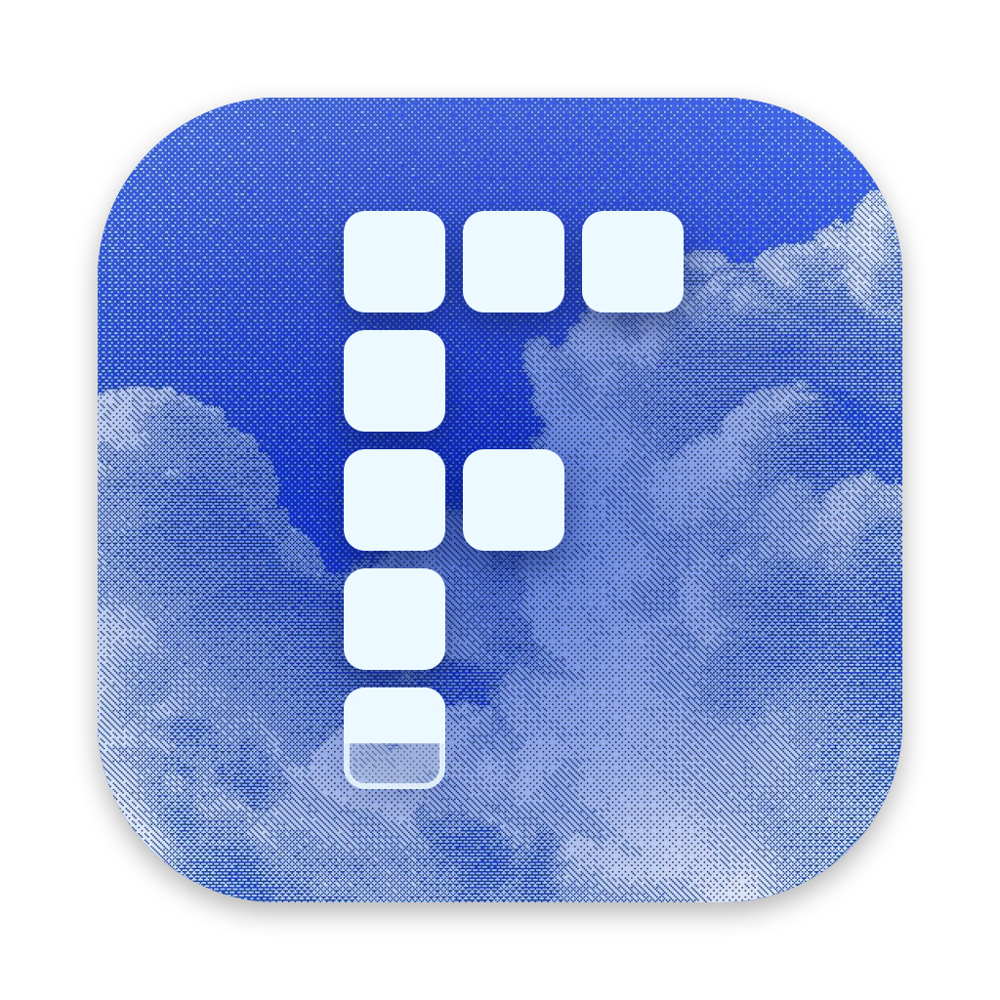

# Flux — Brand

**Everything you download. Under control.**

## Motif

A **halftone blue sky with white cumulus clouds**. The clouds say *the internet*; the
halftone dot pattern says *data, transferred piece by piece*: exactly what Flux's
multi-connection engine does. Source image: `Resources/Brand/sky-halftone.jpg`
(1358 × 1697).

## Palette (measured from the source image)

| Name | Hex | Role |
|---|---|---|
| Flux Blue (ink) | `#2D57D5` | Primary brand color, accent in light mode, progress bars |
| Cloud White (paper) | `#ECF9FE` | Highlights, text on blue, logo negative space |
| Sky (blend) | `#5D80D8` | How ink + paper read at a distance; secondary surfaces |
| Flux Blue, dark mode | `#6F92F2` | Accent in dark mode (lifted for contrast) |

Defined in code in `Sources/Flux/Theme/FluxTheme.swift`; never hard-code these elsewhere.

## Usage in the app

- The sky image sits behind the main window, Settings and the Add sheet at **16 % opacity
  in light mode, 22 % in dark mode**, so text stays readable.
- Controls and progress use the Flux Blue accent.
- Native materials (sidebar, toolbar, status bar) stay native; the sky shows through
  translucent areas.
- Empty states use cloud SF Symbols (`icloud.and.arrow.down`).

## Logo

An **F assembled from download chunks** on the halftone sky. Each rounded square is one
piece of a file arriving over its own connection, the way Flux's multi-connection engine
splits a download. The last chunk, at the foot of the stem, is still filling from the top
down: a download in progress, moving downward.

- **Background:** the sky image at 1:1 (no resampling, so the halftone dots stay crisp),
  open sky at the top and cumulus rising from the bottom. A multiply veil in Flux Blue
  deepens the centre so the Cloud White F reads clearly.
- **Mark:** a 3 × 5 grid of Cloud White chunks with a soft ink shadow. It's nudged right
  of centre so it looks centred.
- **Small sizes (≤ 32 px):** flat Sky → Flux Blue gradient, no halftone, with tighter
  gaps (requirement 3 below).
- **Source of truth:** `scripts/make-icon.swift` generates `Resources/Brand/AppIcon-1024.png`
  and `Resources/Brand/Flux.icns`, which `build-app.sh` bundles. Edit the script, not the PNGs.

Still to do: a monochrome menu bar glyph (the chunked F as a template image) and the
"Flux" wordmark.

### Original requirements

Requirements:
1. Built from the halftone sky: a cloud silhouette rendered in Flux Blue halftone dots
   on Cloud White, or the reverse.
2. A downward motion inside or below the cloud (arrow or falling dots, like rain or
   data coming down) for "download".
3. Works as a macOS app icon (rounded square, legible at 16 px: at small sizes,
   switch from halftone dots to a solid cloud shape) and as a monochrome menu bar glyph.
4. Wordmark "Flux" set in a clean geometric sans, Flux Blue.
